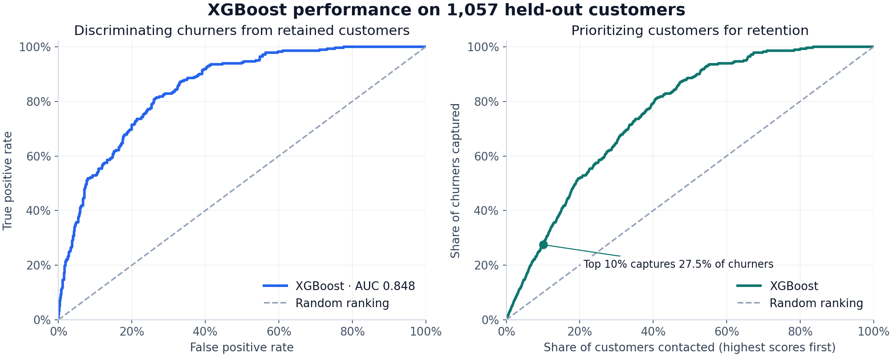
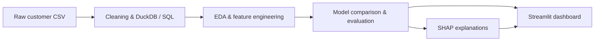
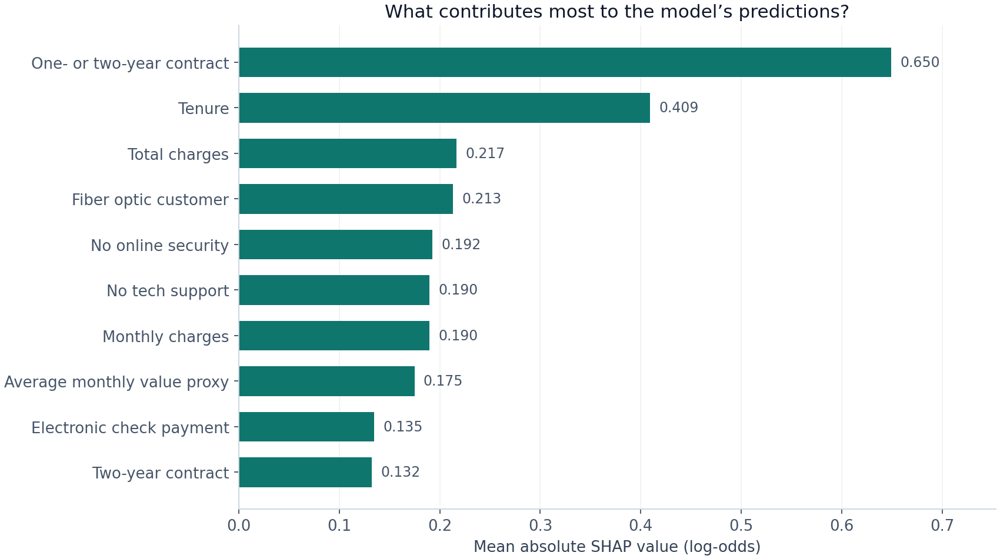

# Customer Churn Prediction

An **end-to-end machine learning project** for predicting telecom customer churn, explaining the predictions, and exploring customer risk in a Streamlit dashboard. It covers CSV cleaning, SQL data preparation, exploratory analysis, feature engineering, model comparison, and explainability.

I built this project to understand which customers are likely to leave and how a model could help prioritize a retention campaign. The final XGBoost model achieves **0.8482 test ROC-AUC** and captures **27.5% of churners within the highest-risk 10% of customers**—roughly **2.75× random targeting**.



[Results](#results) · [Dashboard](#dashboard) · [Run locally](#run-locally) · [Notebooks](#notebooks-and-project-structure)

## How it works



The project uses the [IBM Telco Customer Churn dataset](https://github.com/IBM/telco-customer-churn-on-icp4d/blob/master/data/Telco-Customer-Churn.csv), with **7,043 customers** and an overall churn rate of **26.54%**. It includes customer demographics, services, contract terms, tenure, and billing information. Eleven blank total-charge values are treated as missing and handled through imputation.

I added eight features covering tenure groups, contract length, monthly charges, service adoption, payment behavior, and support/security services. Each model uses a scikit-learn pipeline for imputation, numerical scaling, and one-hot encoding. Customer IDs are excluded from model inputs.

Data is split into approximately **70% training, 15% validation, and 15% test**, stratified by churn status with a fixed random seed of 42. Preprocessing is fitted on training data during model comparison. The selected pipeline is then refitted on training and validation data before test evaluation.

## Results

Logistic Regression, Random Forest, and XGBoost were compared using class weighting. XGBoost was selected for its highest validation average precision:

| Model | Validation ROC-AUC | Validation average precision |
| --- | ---: | ---: |
| Logistic Regression | 0.8322 | 0.6379 |
| Random Forest | 0.8323 | 0.6281 |
| **XGBoost** | **0.8322** | **0.6413** |

The models are close on validation; XGBoost has a small advantage in average precision. Its final results on the **1,057-customer test set** are:

| Metric | Value |
| --- | ---: |
| ROC-AUC | **0.8482** |
| Average precision (PR-AUC in the notebooks) | **0.6519** |
| Precision | 0.5274 |
| Recall | 0.7893 |
| F1-score | 0.6323 |
| Recall@Top10% | **0.2750** |

Precision, recall, and F1 above use the default **0.50 threshold**, matching the dashboard overview. The artifact also stores the validation-selected threshold of **0.52**, whose test F1 is **0.6274**. Both settings are reported in the modeling notebook.

For customer prioritization, Recall@Top10% is especially useful: selecting the 10% with the highest scores captures **27.5% of test-set churners**. The cumulative gains chart above shows how that coverage changes with campaign size.

## What drives the predictions?



Contract commitment and tenure contribute most to the model’s predictions, followed by billing, internet service, and support/security features. The chart shows contribution magnitude; the [explainability notebook](notebooks/04_explainability.ipynb) also examines direction through a beeswarm plot and individual customer explanations.

The cohort comparison gives these patterns a more concrete interpretation:

| Test-set characteristic | Highest-risk 10% | Lowest-risk 10% |
| --- | ---: | ---: |
| Observed churn rate | **72.64%** | **0.00%** |
| Month-to-month contract | 100.00% | 0.00% |
| Fiber optic internet | 89.62% | 5.66% |
| Two-year contract | 0.00% | 89.62% |

Within the highest-risk group, **91.51%** are customers with less than 12 months of tenure, and over **96%** have no tech support. These profiles suggest useful segments for investigating onboarding and retention offers. They describe associations in this sample, rather than measured effects of those offers.

## Dashboard

The [Streamlit app](app/streamlit_app.py) brings the analysis together in one interface. It displays model metrics, SHAP importance, score distributions, and comparisons between high-risk and low-risk profiles. Sidebar controls let you filter risk categories, adjust the number of displayed features and records, and export the selected high-risk records as CSV.

The dashboard loads the saved model, test data, and explanation reports generated by the notebooks.

```bash
streamlit run app/streamlit_app.py
```

## Run locally

From the repository root, create a virtual environment and install the dependencies:

```bash
python3 -m venv .venv
source .venv/bin/activate
pip install -r requirements.txt
```

On Windows, use `.venv\Scripts\activate` to activate the environment.

The source CSV is included at `data/raw/telco_churn.csv`. Load it into DuckDB:

```bash
python src/load_data.py
```

Launch Jupyter from the `notebooks/` directory so that the notebook paths resolve correctly:

```bash
cd notebooks
jupyter notebook
```

Select the project environment as the kernel and run all cells in notebooks **01 → 02 → 03 → 04**. This generates the processed datasets, model artifact, and reports required by the dashboard.

Then, from the repository root:

```bash
streamlit run app/streamlit_app.py
```

Generated files in `data/processed/`, `models/`, and `reports/` are excluded from version control, so the notebooks must be run before launching the dashboard on a fresh checkout.

## Notebooks and project structure

| Notebook | Contents |
| --- | --- |
| [01 · Exploratory analysis](notebooks/01_eda.ipynb) | Data quality, churn rates, and customer segments |
| [02 · Feature engineering](notebooks/02_feature_engineering.ipynb) | Derived features, stratified splits, and preprocessing |
| [03 · Modeling](notebooks/03_modeling.ipynb) | Model comparison, threshold tuning, and test evaluation |
| [04 · Explainability](notebooks/04_explainability.ipynb) | SHAP analysis, individual explanations, and risk cohorts |

```text
├── app/                # Streamlit dashboard
├── data/
│   ├── raw/            # Source CSV
│   └── processed/      # Generated DuckDB database and data splits
├── docs/images/        # README figures
├── models/             # Generated model and preprocessing artifacts
├── notebooks/          # Analysis, modeling, and explainability
├── reports/            # Generated metrics and explanation tables
├── sql/                # Database schema and feature queries
├── src/                # Data loading and configuration
└── requirements.txt
```

**Tools:** Python, pandas, NumPy, DuckDB, scikit-learn, XGBoost, SHAP, Matplotlib, Seaborn, and Streamlit.
