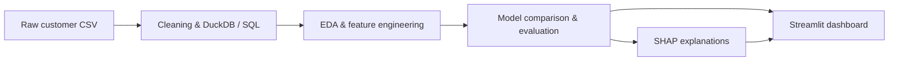
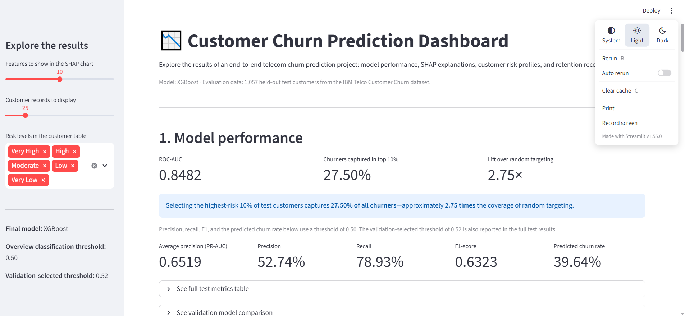

# Customer Churn Prediction

An **end-to-end machine learning project** that predicts telecom customer churn, explains individual predictions, and turns model scores into customer priorities through a Streamlit dashboard.

I built the workflow from raw CSV data through SQL preparation, exploratory analysis, feature engineering, model evaluation, and SHAP explanations. The final XGBoost pipeline achieves **0.8482 test ROC-AUC** and identifies **27.5% of churners within the highest-risk 10% of customers**—approximately **2.75× the coverage of random targeting**.

The business goal is to help a retention team decide which customers to contact first when campaign capacity is limited.

**Stack:** Python · SQL / DuckDB · pandas · scikit-learn · XGBoost · SHAP · Streamlit

[Results](#results) · [Explainability](#explaining-the-predictions) · [Dashboard](#dashboard) · [Run locally](#run-locally) · [Notebooks](#notebooks-and-project-structure)


## What I built



- **Data preparation:** a Python loader cleans column names and data types, loads the customer table into DuckDB, and creates a SQL feature view.
- **Feature engineering:** eight derived features summarize tenure, contract commitment, billing, service adoption, payment behavior, and support subscriptions.
- **Modeling:** scikit-learn pipelines combine preprocessing with Logistic Regression, Random Forest, or XGBoost. Model comparison and threshold selection use validation data.
- **Explainability:** global SHAP analysis, contribution summaries by theme, two individual customer explanations, and comparisons of high-risk and low-risk groups.
- **Dashboard:** an interactive view of performance, feature contributions, risk scores, and customer records, with filters and CSV export.

## Data and evaluation approach

The [IBM Telco Customer Churn dataset](https://github.com/IBM/telco-customer-churn-on-icp4d/blob/master/data/Telco-Customer-Churn.csv) contains **7,043 customers**, with a churn rate of **26.54%**. It includes demographics, subscribed services, contract terms, tenure, and billing information. The source CSV is included in the repository.

Eleven blank total-charge values are converted to missing values and handled through imputation. Customer IDs are excluded from model inputs.

The data is split into **4,929 training**, **1,057 validation**, and **1,057 test** customers—approximately 70% / 15% / 15%. Both splits are stratified by churn status and use a fixed random seed of 42.

During model comparison, each pipeline fits imputation, numeric scaling, and one-hot encoding on the training set. Class weighting accounts for the imbalance between churners and non-churners. After selection, the final pipeline is refitted on the combined training and validation sets and evaluated on the held-out test set.

## Results

XGBoost was selected for the highest validation average precision. Logistic Regression provides a competitive baseline, with a small gap between the two models:

| Model | Validation ROC-AUC | Validation average precision |
| --- | ---: | ---: |
| Logistic Regression | 0.8322 | 0.6379 |
| Random Forest | 0.8323 | 0.6281 |
| **XGBoost** | **0.8322** | **0.6413** |

The selected XGBoost pipeline achieves the following results on the **1,057-customer test set**:

| Metric | Value |
| --- | ---: |
| ROC-AUC | **0.8482** |
| Average precision | **0.6519** |
| Precision | 0.5274 |
| Recall | 0.7893 |
| F1-score | 0.6323 |
| Recall@Top10% | **27.50%** |
| Lift@Top10% | **2.75×** |

At the default threshold of **0.50**, the model identifies about **79% of churners**, with precision of about **53%**. For a campaign targeting the highest-risk 10% instead, the ranking captures **27.5% of test-set churners**. The cumulative gains chart shows how coverage changes as more customers are selected.

Threshold tuning selected **0.52** on validation F1. Its test F1 is **0.6274**, compared with **0.6323** at 0.50. The saved artifact retains the validation-selected threshold; the table above and dashboard overview report classification metrics at 0.50. Average precision is labeled `pr_auc` in the code and report files.

## Explaining the predictions


Contract commitment and tenure have the largest individual mean absolute SHAP contributions. Billing, internet service, support subscriptions, and payment behavior provide further detail about the model's predictions.

The [explainability notebook](notebooks/04_explainability.ipynb) examines these contributions through global rankings, a beeswarm plot, theme summaries, and individual waterfall plots. Related features, such as `contract` and `long_contract`, are interpreted together.

Comparing the two ends of the risk ranking makes the customer profiles more concrete:

| Test-set characteristic | Highest-risk 10% | Lowest-risk 10% |
| --- | ---: | ---: |
| Observed churn rate | **72.64%** | **0.00%** |
| Month-to-month contract | 100.00% | 0.00% |
| Fiber optic internet | 89.62% | 5.66% |
| Two-year contract | 0.00% | 89.62% |

In the highest-risk group, **91.51%** have less than 12 months of tenure and **96.23%** have no tech support. These findings support prioritizing early customer outreach and investigating the experience of fiber optic customers without support services. They also inform segments for testing contract, support, or payment-related offers. Campaign evaluation would measure whether those offers improve retention.

## Dashboard



The [Streamlit dashboard](app/streamlit_app.py) connects the modeling results to customer exploration:

- Headline performance and targeting metrics, with detailed test results and validation comparisons.
- SHAP importance charts with readable feature labels.
- Customer score distributions and risk groups.
- Customer records ranked by risk, with filters, a display-count control, and CSV export.
- High-risk and low-risk profile comparisons and retention recommendations.

It uses the saved pipeline and reports to score and describe the held-out test customers. After generating the required files, launch it from the repository root:

```bash
streamlit run app/streamlit_app.py
```

Open **http://localhost:8501** in your browser.

## Run locally

From the repository root, create a virtual environment and install the dependencies:

```bash
python3 -m venv .venv
source .venv/bin/activate
pip install -r requirements.txt
```

On Windows, use `.venv\Scripts\activate` to activate the environment.

Load the included CSV into DuckDB:

```bash
python src/load_data.py
```

Launch Jupyter from the `notebooks/` directory so that the notebook paths resolve correctly:

```bash
cd notebooks
jupyter notebook
```

Select the project environment as the kernel and run all cells in notebooks **01 → 02 → 03 → 04**. This generates the processed datasets, fitted model, and explanation reports.

Then return to the repository root and launch the dashboard:

```bash
cd ..
streamlit run app/streamlit_app.py
```

Generated files in `data/processed/`, `models/`, and `reports/` are excluded from version control. Run the notebooks before launching the dashboard on a fresh checkout.

## Notebooks and project structure

| Notebook | Contents |
| --- | --- |
| [01 · Exploratory analysis](notebooks/01_eda.ipynb) | Data quality, churn rates, and customer segments |
| [02 · Feature engineering](notebooks/02_feature_engineering.ipynb) | Eight derived features, stratified splits, and preprocessing |
| [03 · Modeling](notebooks/03_modeling.ipynb) | Model comparison, threshold tuning, test evaluation, and decile analysis |
| [04 · Explainability](notebooks/04_explainability.ipynb) | Global and local SHAP analysis, risk profiles, and retention recommendations |

```text
├── app/                # Streamlit dashboard
├── data/
│   ├── raw/            # Source CSV
│   └── processed/      # Generated DuckDB database and data splits
├── docs/images/        # README figures
├── models/             # Generated model and preprocessing artifacts
├── notebooks/          # Analysis, modeling, and explainability
├── reports/            # Generated metrics and explanation tables
├── sql/                # Database schema and feature queries
├── src/                # Data loading and configuration
└── requirements.txt
```
